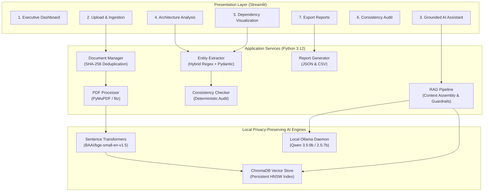

# AI-Powered AUTOSAR High-Level Design (HLD) Document Analysis Assistant

An enterprise-grade, privacy-preserving engineering assistant designed for automotive software architects, safety engineers, and integration leads. The application ingests, indexes, queries, visualizes, and audits AUTOSAR Classic and Adaptive Platform High-Level Design (HLD) specifications using fully local Retrieval-Augmented Generation (RAG).

---

## 1. System Architecture



---

## 2. Key Features

1. **Local Privacy-Preserving Execution**: Operates 100% offline. Zero telemetry, zero external API keys, zero cloud data leakage.
2. **PyMuPDF Document Ingestion**: Fast extraction of text, font-size heading heuristics, and signal tables with page preservation.
3. **ChromaDB & BGE Vector Knowledge Base**: Overlapping chunks (500 tokens, 60 overlap) indexed using `BAAI/bge-small-en-v1.5`.
4. **Grounded Anti-Hallucination RAG**: Enforces strict citation formatting `[Source: <filename>, Page <X>]` and explicitly declines absent facts.
5. **AUTOSAR Entity Extraction**: Pydantic-validated extraction of Software Components (SWCs), Sender-Receiver & Client-Server Port Interfaces, Signals, and Candidate Dependencies.
6. **Interactive Dependency Graph**: Dynamic directed graph rendered via NetworkX and Plotly distinguishing Candidate vs Reviewed relationships.
7. **Deterministic Consistency Audits**: Automated detection of duplicate SWC declarations, dangling component references, and interface naming anomalies.
8. **Multi-Format Export**: One-click download of full JSON architecture reports and CSV inventories for components, interfaces, signals, and audit findings.

---

## 3. Technology Stack

| Layer | Technology | Version | Purpose |
|---|---|---|---|
| Runtime | Python | 3.11 / 3.12 | Core execution environment |
| UI Framework | Streamlit | ≥ 1.38.0 | Interactive engineering dashboard |
| PDF Engine | PyMuPDF (fitz) | ≥ 1.24.0 | Page-wise text, table, and heading extraction |
| Embeddings | Sentence-Transformers | ≥ 3.0.0 | BAAI/bge-small-en-v1.5 (384 dimensions) |
| Vector Store | ChromaDB | ≥ 0.5.0 | Persistent in-process vector database |
| Local LLM | Ollama (Qwen 3.5:9b) | 0.34.2 | Offline causal transformer inference |
| Data Validation | Pydantic v2 | ≥ 2.5.0 | Schema validation for extracted architecture entities |
| Visualization | NetworkX + Plotly | ≥ 3.2 / 5.18 | Component dependency directed graph |
| Data Processing | Pandas & OpenPyXL | ≥ 2.1 / 3.1 | Tabular reporting, JSON and Excel generation |

---

## 4. Windows Installation & Setup Guide

### Step 1: Clone Repository and Navigate to Code Directory
```powershell
git clone <repo-url>
cd AUTOSAR_HLD_Analysis_Assistant\3_Code
```

### Step 2: Create and Activate Virtual Environment
```powershell
python -m venv venv
.\venv\Scripts\Activate.ps1
```
*(If PowerShell restricts execution, run `Set-ExecutionPolicy -Scope Process -ExecutionPolicy Bypass` first)*

### Step 3: Install Required Dependencies
```powershell
pip install -r requirements.txt
```

### Step 4: Install and Start Ollama
1. Download Ollama for Windows from [https://ollama.ai/download](https://ollama.ai/download).
2. Run the installer `OllamaSetup.exe`.
3. Open a new terminal and download the recommended model:
```powershell
ollama pull qwen3.5:9b
# (Alternative lightweight model: ollama pull qwen2.5:7b or qwen2.5-coder:3b)
```

### Step 5: Generate the Synthetic Demonstration PDF
```powershell
python sample_data\generate_sample_hld.py ..\2_Input_Data\Sample_AUTOSAR_HLD.pdf
```

### Step 6: Start the Streamlit Application
```powershell
streamlit run app.py
```
The browser will automatically open at `http://localhost:8501`.

---

## 5. Linux / macOS Setup Guide

```bash
# 1. Setup virtual environment
python3 -m venv venv && source venv/bin/activate

# 2. Install dependencies
pip install -r requirements.txt

# 3. Pull Ollama model
ollama pull qwen3.5:9b

# 4. Generate demonstration dataset
python sample_data/generate_sample_hld.py ../2_Input_Data/Sample_AUTOSAR_HLD.pdf

# 5. Launch application
streamlit run app.py
```

---

## 6. End-to-End Walkthrough & Usage

### 1. Ingesting Documents
- Navigate to **"2. Upload Documents"** in the sidebar.
- Upload `Sample_AUTOSAR_HLD.pdf` (or any AUTOSAR HLD PDF).
- The document is automatically validated, chunked, and embedded into persistent ChromaDB storage.
- If an uploaded document is scanned without text, an explicit warning is displayed.

### 2. Asking Technical Questions
- Navigate to **"3. AI Document Assistant"**.
- Click one of the quick chips or type a question:
  - *"What are the major software components?"*
  - *"Which interfaces are used by BrakeControlSWC?"*
  - *"Explain the regenerative braking functional flow."*
- Notice the grounded response containing mandatory citations `[Source: Sample_AUTOSAR_HLD.pdf, Page X]`.
- Click **"View Source Citations & References"** to inspect the exact retrieved text passages.

### 3. Extracting Architecture Entities
- Navigate to **"4. Architecture Analysis"**.
- Click **"Run Architecture Entity Extraction"**.
- View structured tables for Software Components, Port Interfaces, Signals, and Dependencies.
- Click **"Generate Technical Summary"** for an executive architectural brief.

### 4. Exploring the Component Dependency Graph
- Navigate to **"5. Dependency Visualization"**.
- Explore the interactive Plotly graph of component nodes and directed dependencies.
- Review and promote "Candidate" dependencies to "Reviewed" status.

### 5. Running Consistency Audits
- Navigate to **"6. Consistency Checks"**.
- Deterministic checks flag duplicate names, dangling component references, and interface naming variations.

### 6. Exporting Engineering Reports
- Navigate to **"7. Export Reports"**.
- Download complete JSON architectural models and CSV domain inventories.

---

## 7. Running Unit & Integration Tests

Execute the automated test suite with pytest:
```bash
pytest tests/ -v
```

Expected output:
```text
tests/test_pdf_processor.py::test_pdf_processing_and_chunking PASSED
tests/test_pdf_processor.py::test_empty_pdf_detection PASSED
tests/test_entity_extractor.py::test_rule_based_entity_extraction PASSED
tests/test_consistency_checker.py::test_consistency_checks_detection PASSED

======================== 4 passed in 1.45s ========================
```

---

## 8. Project Limitations & Future Enhancements

### Current Limitations:
1. **Scanned PDFs**: Scanned image-only PDFs require pre-OCR processing (e.g. Tesseract). The assistant safely flags them.
2. **Vector Scope**: Complex multi-hop queries across dozens of documents benefit from graph-augmented retrieval.

### Future Enhancements:
- **ARXML Bi-Directional Export**: Direct export of extracted components into AUTOSAR XML (`.arxml`) compliant with AUTOSAR Classic R4.4 Schema.
- **REST API Layer**: Modular backend architecture allows exposing FastAPI endpoints for CI/CD integration.
- **ASIL-D Traceability Matrix**: Automated cross-linking between safety goals in SysML/Enterprise Architect and AUTOSAR runnables.
